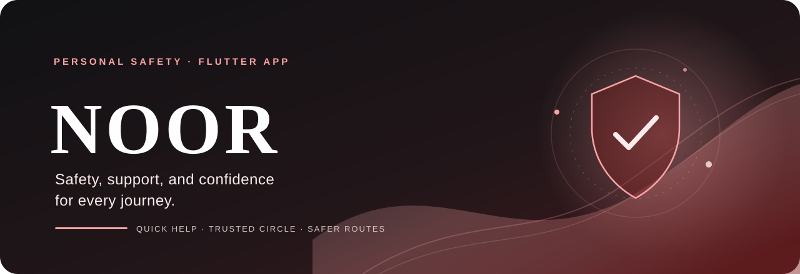
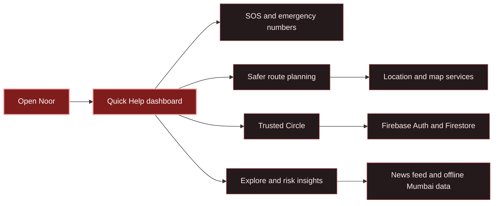
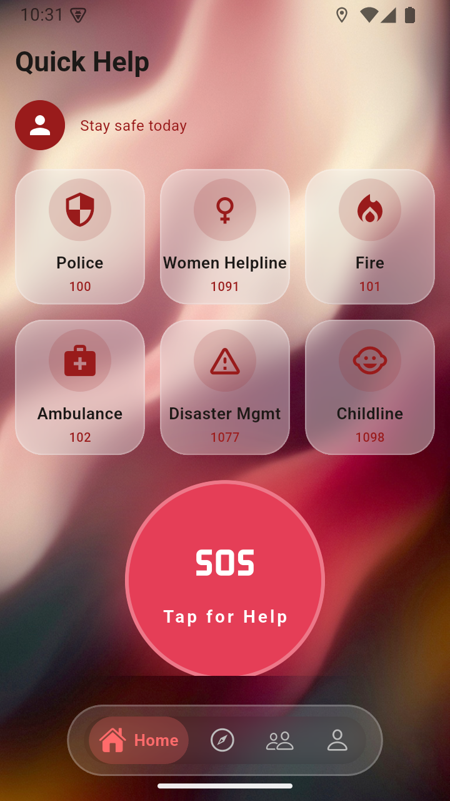
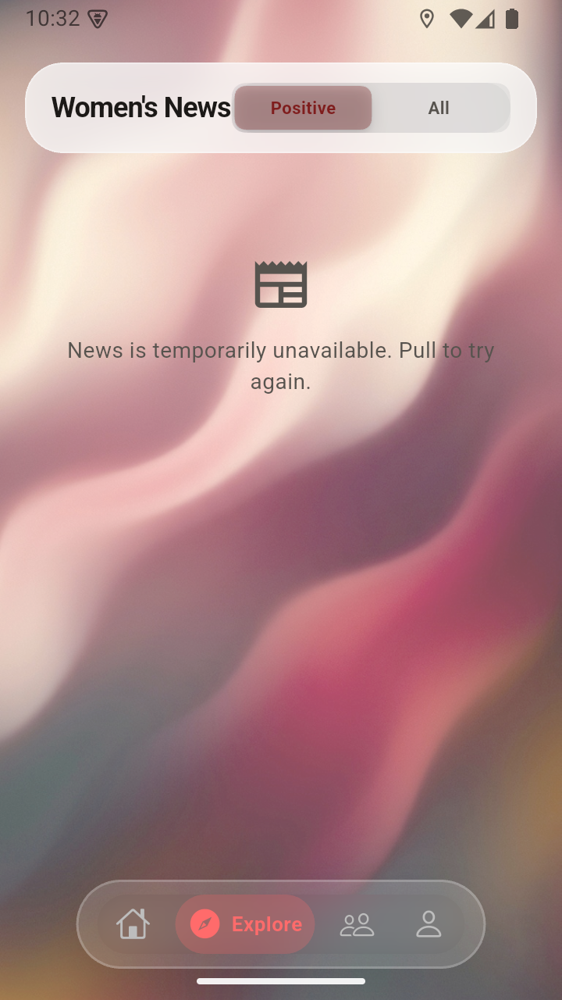
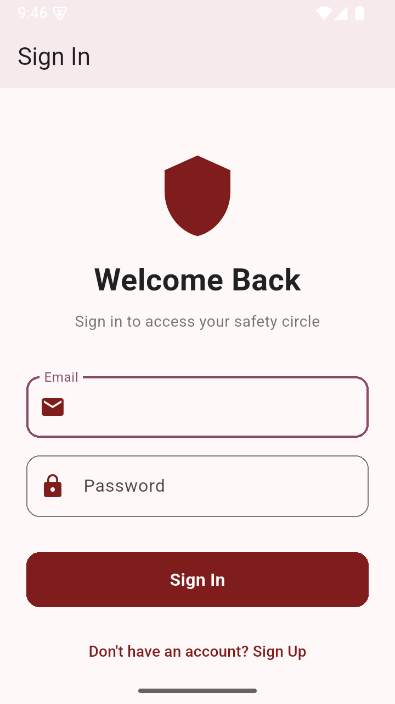
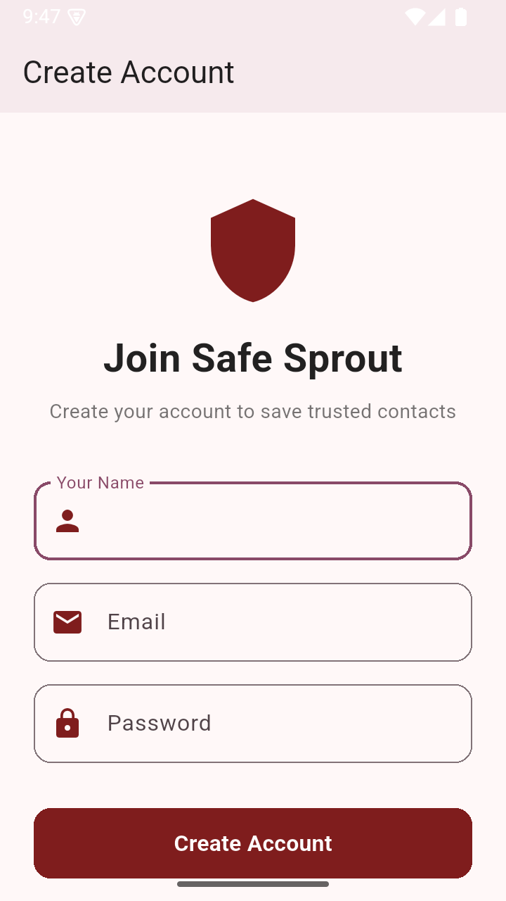

<div align="center">

<a href="https://github.com/Dhvani30/Noor" aria-label="Open the Noor GitHub repository">
  
</a>

<br />

<a href="#the-noor-experience"></a>
<a href="#the-noor-experience"></a>
<a href="#getting-started"></a>
<a href="LICENSE"></a>

<p><strong>A personal safety companion for more confident journeys.</strong><br />Emergency help, trusted people, safer routes, and local risk insights in one Flutter app.</p>

<p>
  <a href="#the-noor-experience">Explore Noor</a> ·
  <a href="#screens-in-the-app">Screenshots</a> ·
  <a href="#getting-started">Get started</a> ·
  <a href="#project-map">Project map</a>
</p>

</div>

<br />

> **A note on safety** · Noor is a support tool. Emergency numbers, risk estimates, and route guidance are informational; use local emergency services and your own judgment when you need help.

---

<a id="the-noor-experience"></a>

## 01 · The Noor experience

Noor brings practical safety tools together in a calm, easy-to-reach interface. A single dashboard puts emergency contacts and SOS actions up front, while the rest of the app supports planning, check-ins, and awareness along the way.

<table>
  <tr>
    <td width="50%"><strong>🆘 Quick Help</strong><br />One-tap access to SOS and useful emergency numbers.</td>
    <td width="50%"><strong>🗺️ Safer routes</strong><br />Plan routes with map and location support.</td>
  </tr>
  <tr>
    <td><strong>🤝 Trusted Circle</strong><br />Keep trusted contacts close and ready to reach.</td>
    <td><strong>📍 Local awareness</strong><br />Explore Mumbai risk data, heatmaps, and danger-zone alerts.</td>
  </tr>
  <tr>
    <td><strong>📞 Fake call</strong><br />Schedule a simulated call as a personal safety tool.</td>
    <td><strong>📰 Explore</strong><br />Browse safety news, with a clear retry state if the feed is offline.</td>
  </tr>
</table>

### How it fits together



---

<a id="screens-in-the-app"></a>

## 02 · Screens in the app

These are real captures from the Noor Android emulator (720 × 1280). The News screen shows Noor's friendly fallback when the configured feed cannot be reached.

<table>
  <tr>
    <td align="center" width="50%"><strong>Quick Help</strong><br /></td>
    <td align="center" width="50%"><strong>Explore · offline fallback</strong><br /></td>
  </tr>
  <tr>
    <td align="center"><strong>Sign in</strong><br /></td>
    <td align="center"><strong>Create account</strong><br /></td>
  </tr>
</table>

---

## 03 · Built with

| Area | Technology |
|:--|:--|
| Mobile app | Flutter and Dart |
| Authentication and cloud data | Firebase Authentication and Cloud Firestore |
| Maps and routes | Mapbox, Flutter Map, and device location |
| Offline awareness | Bundled Mumbai risk data and heatmap tiles |
| App state and preferences | Provider and SharedPreferences |
| Device features | Contacts, notifications, alarms, battery, and location plugins |

---

<a id="getting-started"></a>

## 04 · Getting started

### Requirements

- Flutter SDK with Dart `^3.10.8`
- Android SDK and an Android device or emulator
- Firebase Android app configuration
- Mapbox access token for Mapbox-powered features
- NewsAPI key for live Explore articles (optional)

### 1. Get the code

```bash
git clone <repository-url>
cd Noor
flutter pub get
```

### 2. Add local environment values

Create the `.env` file expected by the app:

```bash
cp .env.example .env
```

Then fill in the values you need:

| Key | Required | Used for |
|:--|:--:|:--|
| `MAPBOX_ACCESS_TOKEN` | For map features | Map search and route experiences |
| `NEWS_API_KEY` | Optional | News articles in Explore |

The app can still open without a NewsAPI key; Explore displays a retry message when no articles can be loaded. Keep your `.env` file private. Android Mapbox Maps also needs its token configured for the manifest placeholder in `android/app/build.gradle.kts`.

### 3. Configure Firebase

Add your Firebase Android configuration at `android/app/google-services.json` and register the package `com.example.noor_new` in the Firebase project. Firebase initialization is required when the app launches.

Trusted Circle stores contacts at `users/{uid}/trustedContacts`. Its Firestore rules should limit profile and contact access to the authenticated owner. For a new project, this is a minimal owner-scoped starting point; merge it with your existing rules before publishing:

```text
rules_version = '2';
service cloud.firestore {
  match /databases/{database}/documents {
    match /users/{userId} {
      allow read, write: if request.auth != null && request.auth.uid == userId;

      match /trustedContacts/{contactId} {
        allow read, write: if request.auth != null && request.auth.uid == userId;
      }
    }
  }
}
```

If the rules have not been published, Noor can still show the Trusted Circle screen, but contacts will not sync to Firestore.

### 4. Launch Noor

```bash
flutter run
```

Grant device permissions when prompted to enable features such as location and contacts.

---

<a id="project-map"></a>

## 05 · Project map

```text
lib/
├── main.dart                 # App startup, Firebase, providers, and theme
├── home_page.dart            # Main navigation and Quick Help dashboard
├── circle_page.dart          # Trusted contacts
├── news_page.dart            # Explore news
├── profile_page.dart         # Profile and preferences
├── screens/                  # Authentication, maps, routes, and fake call flows
├── services/                 # Auth, SOS, risk, routing, and call services
├── providers/                # App state
├── widgets/                  # Reusable interface components
└── theme/                    # Colors and theme configuration

assets/
├── data/                     # Emergency numbers and Mumbai risk data
├── images/                   # App icon and backgrounds
└── tiles/                    # Offline heatmap tiles

docs/
├── noor-banner.svg           # README artwork in Noor's app palette
└── screenshots/              # Emulator screenshots used above
```

---

## License

Noor is available under the [MIT License](LICENSE).
